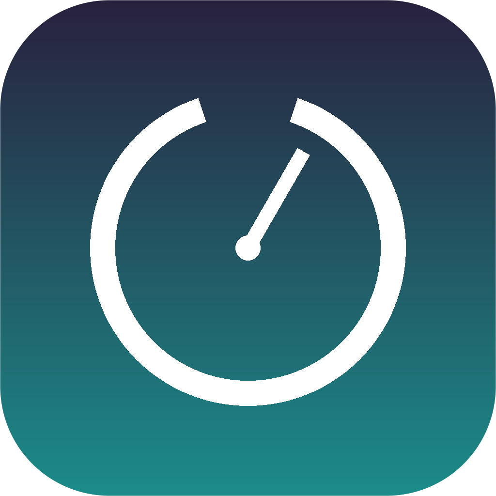

# DayTrace



[](https://github.com/getupandwashits/daytrace/actions/workflows/ci.yml)
[](LICENSE)

DayTrace 是一个独立的 macOS 菜单栏应用，把自动专注计时和可选的前台活动采集整理成便于回看的本地 Markdown 归档。

*DayTrace is a standalone macOS menu bar app for automatic focus timing and optional foreground activity recording. It writes local Markdown archives and does not capture screenshots, record keystrokes or send data over the network.*

- **自动专注**：根据系统闲置时间切换专注、短暂停顿和休息。休息后持续使用键鼠会开始新一轮，到达目标时间会弹出休息卡片。锁屏和睡眠期间挂起计时。
- **活动采集**：开启后每 10 秒采样，检测到切换前台应用时补采。授予辅助功能权限后可读取窗口标题和应用提供的 Accessibility 文本。可在设置里排除应用。
- **归档**：默认北京时间 23:00 归档尚未提交的采样和已结束的专注时段。支持随时手动归档。
- **菜单栏常驻**：在菜单栏打开仪表盘查看概览、专注历史和设置。退出应用即停止采集。

## 安装

当前版本从源码构建。需要 macOS 12 或更新、Go 1.26 或更新，以及 Xcode Command Line Tools。构建脚本使用 Go 1.26.11，以生成面向 macOS 12 的产物。首次构建可由 Go 自动下载这个工具链。

```bash
git clone https://github.com/getupandwashits/daytrace.git
cd daytrace
./scripts/build.sh --install
open /Applications/DayTrace.app
```

也可以只运行 `./scripts/build.sh`，产物位于 `build/DayTrace.app`，架构与构建机器一致。安装前请退出正在运行的 DayTrace。构建产物使用 ad-hoc 签名，适合本机使用。重新构建后，可能需要在系统设置里移除旧的辅助功能条目并重新授权。

## 首次使用

1. 从菜单栏打开仪表盘。专注计时可直接使用。
2. 如需记录前台应用，在「设置 → 活动采集」开启开关并保存。该开关是新安装用户的采集入口。
3. 如需窗口标题和正文，点击「请求辅助功能权限」，在「系统设置 → 隐私与安全性 → 辅助功能」授权 DayTrace。在权限启用前，采集只包含应用名等状态信息。
4. 在设置里确认输出目录。需要立刻生成归档时，从菜单栏或仪表盘选择「立即归档」。

部分应用（例如 Zed）通过 Accessibility 提供的正文不完整。采到的内容和用时属于观测记录，用时根据采样估算。

## 归档和数据

| 内容 | 默认位置 |
| --- | --- |
| 设置和状态 | `~/Library/Application Support/DayTrace/` |
| 活动日志 | `journal/events/YYYY-MM-DD.jsonl` |
| 专注日志 | `sessions/sessions.jsonl` |
| 输出目录 | `archives/`，可在设置里指定其他路径 |

定时归档目录按计划截止时间命名，例如 `2026-11-21_23-00/`。手动目录带 `_manual`，同分钟的后续归档会加序号。每个目录包含：

- `index.md` 提供概况、专注时段、应用用时和原文索引。
- `ui/digest.md` 提供按小时整理的活动摘要。
- `ui/timeline.md` 提供各个观察时段。
- `ui/part-NNN.md` 保存去重的原文。
- `activity.jsonl.gz` 和 `meta.json` 保存活动采样和归档元数据。

跨天启动时，下一次定时归档会补交截止时间前仍在本地的未归档记录。已全部成功归档且超过 7 天的活动日志可以被清理。使用 `export --force` 会另存一份当天仍可读取的活动和专注快照，不改变自动补档的进度。

日志末尾若因写入中断而不完整，DayTrace 会恢复完整记录，并把损坏片段保存为日志旁的 `.damaged-*` 文件供排查。输出目录不可用时，可以在设置里换一个目录再归档。新目录从上一次确认交付的位置继续，旧目录里可能留有一次未登记完成的归档。

从较早的 DayTrace 开发构建升级时，设置和本地日志可继续使用。第一次归档会重新检查手边的日志，部分旧记录可能再归档一次。旧格式归档可独立阅读，新归档使用上面的目录结构。

## 隐私

- 辅助功能权限允许读取当前前台窗口的标题和应用暴露的界面内容，其中可能包括未显示在当前视口的内容。
- DayTrace 跳过标为安全输入的控件，以及内置名单里和能由窗口标题或网址识别的部分密码管理器、浏览器私密窗口。需要保密的应用请加入排除列表，或暂时关闭采集。
- 采集时清理识别出的 HTTP(S) URL 的用户信息、查询参数和片段。摘要额外遮蔽可识别的密钥和密码。活动日志、时间线、原文分段和压缩数据仍可能包含敏感内容，分享前请检查。自选的云同步目录会按相应工具的设置同步。
- 清除 DayTrace 本地数据时，先退出应用，再删除 `~/Library/Application Support/DayTrace`。如果曾选过外部输出目录，请在各目录中单独删除 DayTrace 生成的归档。

## 开发与 CLI

```bash
go test ./...
go vet ./...
go tool viva vet
go tool viva dev .
./scripts/build.sh
```

用隔离目录启动应用：

```bash
DAYTRACE_HOME="$PWD/.dev/home" \
DAYTRACE_OUTPUT="$PWD/.dev/output" \
DAYTRACE_SHOW_DASHBOARD=1 \
./build/DayTrace.app/Contents/MacOS/daytrace
```

`./scripts/build.sh` 同时构建 `.build/daytrace-agent`。这些命令与 GUI 使用相同的数据目录。给调试命令指定 `DAYTRACE_HOME` 和 `DAYTRACE_OUTPUT` 可隔离日志和归档。设置页保存操作不会覆盖 `DAYTRACE_OUTPUT`。

```bash
./.build/daytrace-agent doctor             # 检查路径、权限和最近归档
./.build/daytrace-agent status             # 查看专注状态
./.build/daytrace-agent sample             # 采集一条样本、写入活动日志并打印
./.build/daytrace-agent collect            # 持续采集，Ctrl-C 退出
./.build/daytrace-agent export             # 归档当前未交付的记录
./.build/daytrace-agent export --force     # 另存当天快照
./.build/daytrace-agent export --due       # 检查定时归档
./.build/daytrace-agent analyze YYYY-MM-DD # 查看当天活动计数
./.build/daytrace-agent demo               # 用合成数据跑完整归档
```

`demo` 需要同时指定 `DAYTRACE_HOME` 和 `DAYTRACE_OUTPUT`，请设为临时目录。

## 源码和许可

Go 版由 `cmd/daytrace`、`internal/core`、`internal/macos` 和 `internal/ui` 组成，使用 [Viva](https://github.com/vivaui/viva) 和 macOS 系统框架。[`swift/`](swift/README.md) 保存历史原型。

专注计时的行为参考了 [AutoPomodoro](https://github.com/MaTwickenham/AutoPomodoro)，活动记录来自作者此前的 MyMonitor 实践。归档的分层设计也参考了 [Beayy v0.2.19](https://github.com/hengfengliya/beayy/tree/v0.2.19)。

DayTrace 使用 [MIT 许可证](LICENSE)。第三方组件和构建产物附带的许可见 [THIRD_PARTY_NOTICES.md](THIRD_PARTY_NOTICES.md)。参与开发见 [CONTRIBUTING.md](CONTRIBUTING.md)，隐私与安全问题按 [SECURITY.md](SECURITY.md) 报告。
